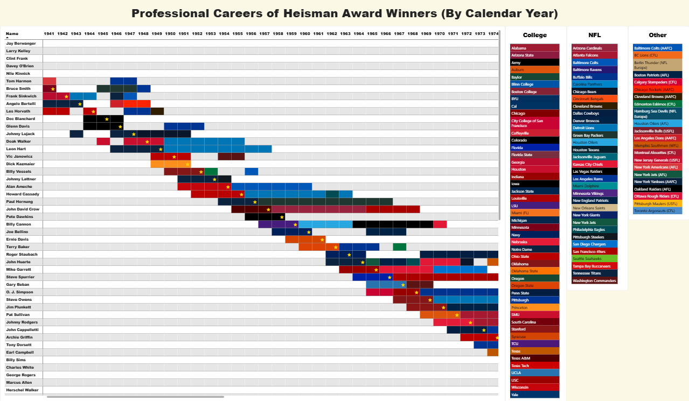
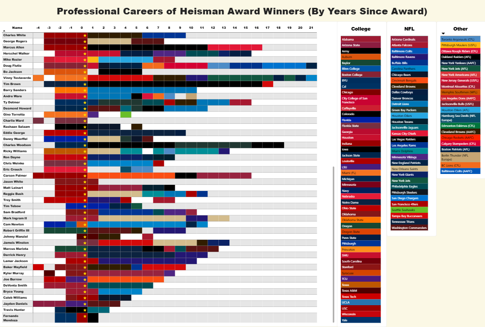
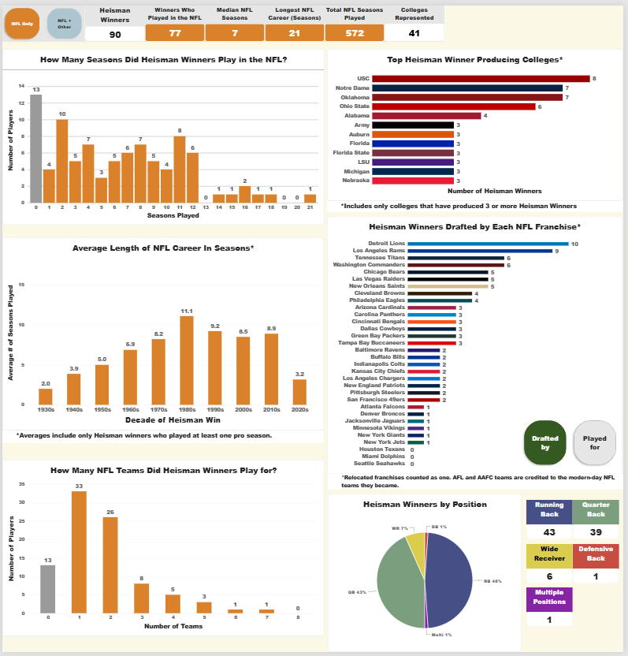
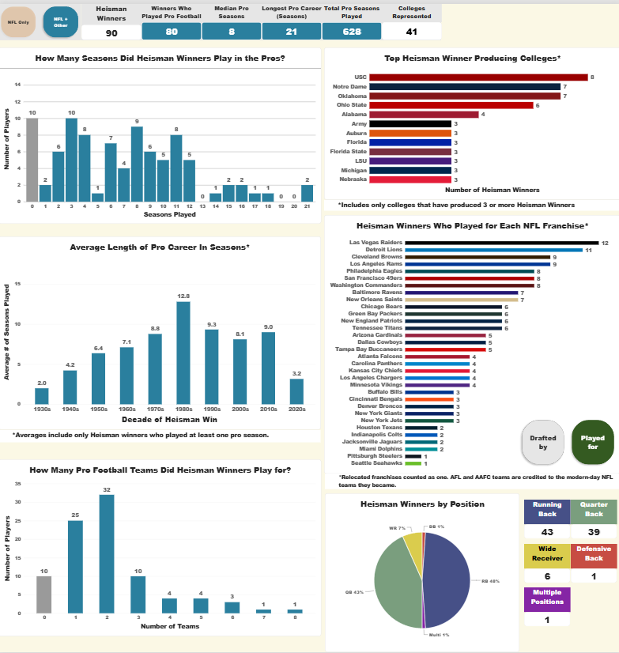

# Heisman Trophy Winners: College and Pro Careers

An interactive Power BI report that follows every Heisman Trophy winner from their first college season through their pro career. It covers all 90 winners from Jay Berwanger (1935) to Fernando Mendoza (2025), with pro seasons through 2026.

## What's in the report

**1. Calendar View.** One row per winner, one column per calendar year. Each cell is colored by the team the player was on that season. A gold star marks the Heisman year. The legend on the right is split into College, NFL and Other teams. Click a winner and the legend dims every team they never played for.

**2. Left-Aligned View.** The same matrix, but the columns are years since the Heisman season, so every career starts at the same point and lengths are easy to compare.

**3. Insights.** Charts built on one summary table of the 90 winners.
- *Left half, controlled by the **NFL Only / NFL + Other** toggle:* seasons played, teams played for, average career length by decade, and KPI cards.
- *Right half, always all 90 winners:* colleges with the most winners, franchises by winners (switch between **Played for** and **Drafted by**), and winners by position.
- The charts cross-highlight. Click a college or a position slice and the other charts show that group.

## Data

All data files are in `data/`. The model runs on these six CSVs.

| File | What it holds |
|---|---|
| `heisman_winners_by_year.csv` | One row per player per season: `Name`, `Heisman_Year`, `Year`, `Level` (College/Pro), `Team`, `Notes`. 937 rows. |
| `team_colors.csv` | 110 teams with a primary color, a category (College / NFL / Other) and legend colors. |
| `franchises.csv` | Maps each team name to its modern franchise (for example Houston Oilers → Tennessee Titans). |
| `nfl_franchises.csv` | The 32 current NFL franchises with colors. Drives the franchise chart. |
| `heisman_positions.csv` | Each winner's position in the Heisman season. |
| `heisman_drafts.csv` | One row per professional draft selection. 99 picks covering 87 of the 90 winners. |

### Rules for what shows up in a season

- One team per player per season. If a player was traded midseason, the season goes to the team they ended on. If a player started on a team and was released as a free agent by season's end, it goes to the team they started with.
- Years lost to military service, redshirts, transfer sit-outs and freshman-squad years are left blank.
- Injured and suspended seasons still count if the player was still on the roster (for example on injured reserve or the PUP list).
- Retirements, preseason cuts and camp-only stints are blank.
- Leagues included: NFL, AFL, AAFC, WFL, USFL, CFL and NFL Europe. XFL, UFL, AAF and FCF are excluded.
- "Seasons played" counts seasons with a team, not the span of a career. A player with one season in 2011 and one in 2015 has 2 seasons, not 5.
- The 2026 season is in progress. Anyone on a 2026 roster is counted for 2026, so active players' totals and the 2020s averages will keep growing.

### How the toggle and franchise views count

- **NFL Only** counts only NFL-league seasons. **NFL + Other** adds AFL, AAFC, CFL, USFL, WFL and NFL Europe seasons.
- The **franchise chart** merges relocated teams into one franchise and credits AFL and AAFC teams to the modern NFL franchise they became. The Browns and 49ers carry AAFC history this way. This is why the franchise chart can credit a player with AFL seasons that NFL Only excludes.
- **Played for** counts winners with at least one season on the franchise.
- **Drafted by** counts every NFL, AFL, AAFC and NFL supplemental draft selection, whether or not the player ever played for that team. A winner picked by two teams (for example Billy Cannon, picked by the Rams in the NFL draft and the Oilers in the AFL draft) counts for both. That is why the bars can add up to more than the number of winners.
- Not counted in Drafted by: expansion drafts, USFL drafts, and picks by defunct franchises (the Brooklyn Dodgers, Boston Yanks and the AAFC's Brooklyn and Chicago teams). Three winners (Pete Dawkins, Charlie Ward and Jason White) were never drafted into the NFL.
- **Positions:** Ends are counted as WR. Travis Hunter is classified **Multi** because he won as a two-way player.

## Sources and how the data was built

- **Pro and college careers.** Compiled with AI assistance (Claude) and then checked **player by player against each winner's English Wikipedia page**. Pro-Football-Reference and cflapedia were used as a second source for the doubtful cases. The full change log is in `docs/pro_career_verification_log.md`. The check corrected the pro careers of 33 players and the college years of 18. A follow-up pass confirmed the college seasons of the remaining winners (the 1935–43 winners, Kazmaier, Vessels, DeVonta Smith and Bryce Young) against Wikipedia, plus the College Football Hall of Fame for Vessels. Nothing changed.
- **Draft selections.** The drafting team for each winner comes from Wikipedia's *List of Heisman Trophy winners*, cross-checked against NFL.com's Heisman draft list. Every AFL pick, AAFC pick and 1984 supplemental-draft pick was confirmed a second time against Wikipedia's draft pages or the player's own page.
- **Injured seasons.** Glenn Davis 1952 is confirmed by the Rams' 1952 roster (listed on injured reserve). Billy Sims 1985 is confirmed by the Lions' 1985 roster and transaction records (physically-unable-to-perform list, then retired in July 1986).
- **Team colors** are primary colors chosen for legibility. They are not official brand specifications.

### Known limitations

- Wikipedia is the main source, so any errors on those pages carry through. Where pages disagreed with each other (for example Davey O'Brien's first TCU season and Billy Vessels' first Oklahoma season, which some sources count as a freshman year), the seasons shown follow the varsity record.
- The 2026 season is still in progress, so current players' totals will keep changing.
- Gaps from military service, suspensions and midseason moves follow the rules above. The specific calls are listed in the verification log.

## Built with

Power BI Desktop (matrix visuals, conditional formatting, DAX measures, a calculated summary table). Open `heisman_report.pbix` in Power BI Desktop, which runs on Windows. If it can't find the data, point it at the CSVs in `data/` under Transform data → Data source settings.

## Disclaimer

An independent project for portfolio purposes. It is not affiliated with the Heisman Trophy Trust, the NCAA, the NFL or any team. Team names and colors are used for identification only.
